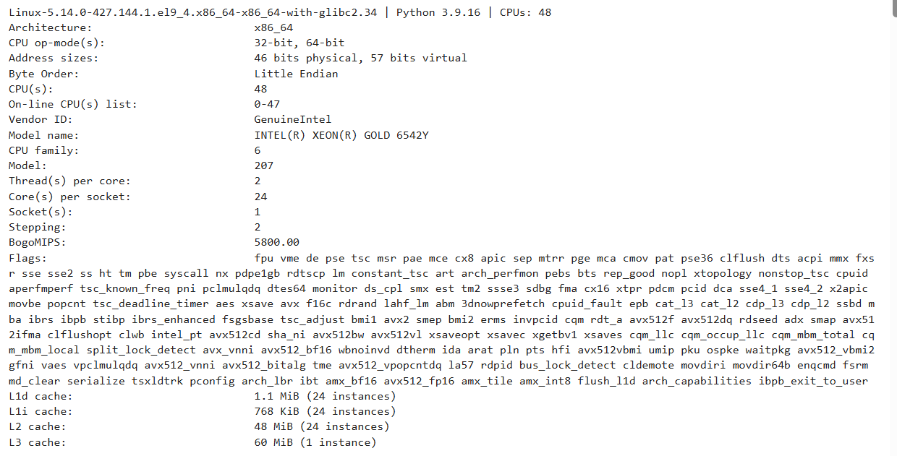
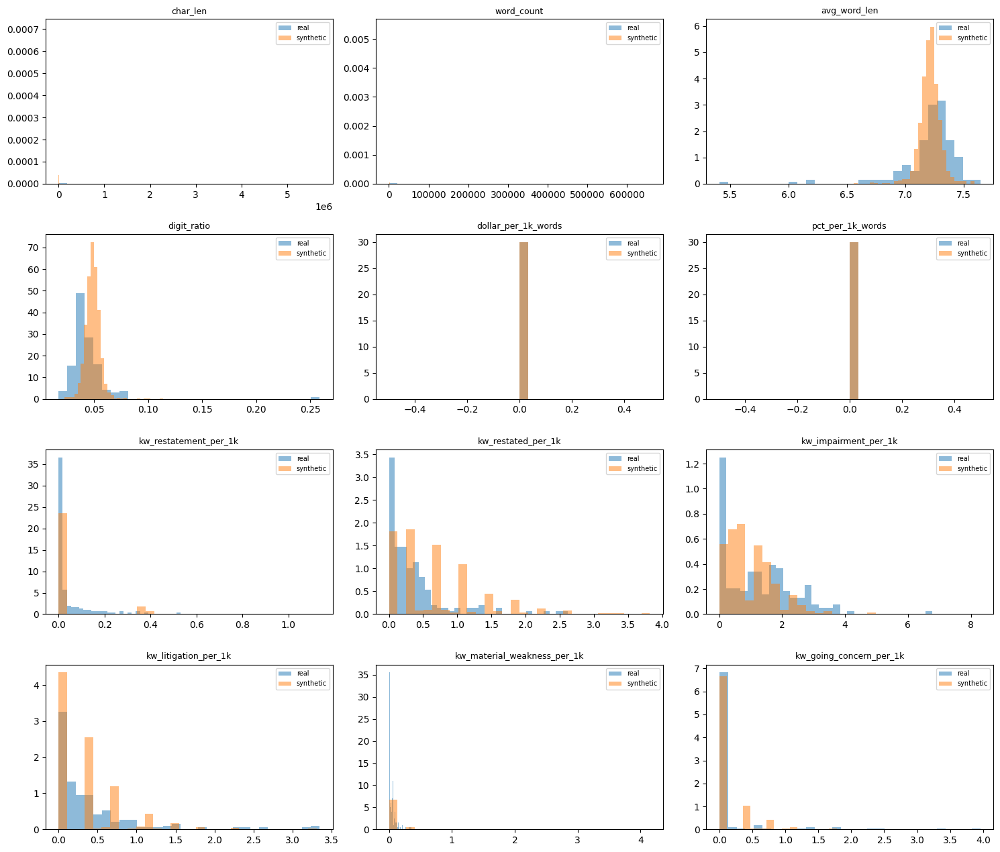

# Synthetic Data Generator Documentation

**Notebook:** `syntheticFraudData.ipynb` (tested in OpenShift)

**Source dataset:** Financial Statement Fraud Data (Kaggle, amitkedia), file `Final_Dataset.csv`.

## Contents

- [1. Summary](#1-summary)
- [2. How the Generator Works](#2-how-the-generator-works)
- [3. Notebook Walkthrough](#3-notebook-walkthrough)
- [4. Reading the Results: Quick Reference](#4-reading-the-results-quick-reference)
- [5. Findings and Limitations](#5-findings-and-limitations)
- [6. Overall Assessment](#6-overall-assessment)
- [7. Next Steps](#7-next-steps)

# 1. Summary

This notebook builds an artificial ("synthetic") copy of a public dataset of company filings so that analysis and model testing can be done without relying on the original records. It then checks how closely the artificial copy resembles the original. This document explains each step of the notebook, what each output, table and chart means, and what the results do and do not show.

**In plain terms:** The notebook learns the typical wording of 170 real company filings, writes 1,000 new filings that sound like them, and runs a series of tests to see whether the new filings behave like the real ones. The labels (fraud / not fraud) and general vocabulary carry over well. The length of the documents does not, and some of the test results need careful reading (Section 5). Section 6 gives an overall assessment and Section 7 sets out the next steps.

## Results at a glance

| **Check**                               | **Result**                                  | **What it means**                                                           |
|-----------------------------------------|---------------------------------------------|-----------------------------------------------------------------------------|
| Real dataset size                       | 170 filings, 2 columns, no missing values   | A small source. Results should be treated as indicative, not conclusive.    |
| Synthetic dataset size                  | 1,000 rows, 2 columns                       | The generator produced about six times as many rows as the original.        |
| Fraud / not-fraud balance               | Real 50.0 / 50.0; synthetic 50.3 / 49.7     | Class balance is preserved.                                                 |
| Rule checks (Cell 10)                   | All 5 passed                                | Basic validity: non-empty text, valid labels, no copied whole documents.    |
| Copied phrases (Cell 11)                | 11.0% of 8-word phrases appear in real text | The synthetic text is partly stitched together from real wording.           |
| Document length (Cell 8)                | Real average 146,149 words; synthetic 2,419 | Not reproduced. Synthetic documents are capped at 3,000 words.              |
| Model test, real on real (Cell 12)      | AUC 0.930                                   | Benchmark: how well a model separates fraud from non-fraud using real data. |
| Model test, synthetic on real (Cell 12) | AUC 0.981, accuracy 0.924                   | Very high, but see the caution in Section 5 before relying on it.           |

# 2. How the Generator Works

## 2.1 The source data

The source file has two columns. "Fillings" (spelled this way in the original dataset) holds the cleaned text of a company filing submitted to the U.S. Securities and Exchange Commission (SEC). "Fraud" is the label: "yes" if the company was involved in a fraud case, "no" if not. There are 170 filings, 85 of each. The text has been pre-processed: it is lower case and punctuation and symbols such as \$ and % have been removed.

## 2.2 The method in five steps

1.  Profile the real data: size, column types, label balance, and a set of numeric measurements of the text (length, keyword rates).

2.  Choose a label for each of the 1,000 new rows by sampling from the real label proportions (50% yes, 50% no).

3.  For each label, learn which words tend to follow which pairs of words in the real filings of that label (a "Markov chain").

4.  Write each new filing one word at a time using those learned patterns, with a target length drawn from real filing lengths.

5.  Compare the new data with the real data using statistics, charts, rule checks, a copy check and a model-based test.

## 2.3 What a Markov chain is

A Markov chain here means: look at the last two words written, find every place those two words appeared together in the real filings, pick whichever word followed them (more common followers are more likely to be picked), and repeat. The result reads like a filing at the level of short phrases, but it has no overall meaning or structure. It is a statistical imitation of wording, not a rewritten filing.

## 2.4 Settings that control the output 

| **Setting**          | **Value** | **Effect**                                                                                                          |
|----------------------|-----------|---------------------------------------------------------------------------------------------------------------------|
| SEED                 | 42        | Fixes the random numbers so a re-run gives the same output.                                                         |
| N_ROWS               | 1000      | Number of synthetic filings generated.                                                                              |
| MARKOV_ORDER         | 2         | Number of preceding words used to choose the next word. Higher gives smoother text but copies more of the original. |
| TRAIN_TOKENS_PER_DOC | 20,000    | Only the first 20,000 words of each real filing are used for learning (limits memory and run time).                 |
| MAX_GEN_WORDS        | 3,000     | Upper limit on synthetic filing length. Setting it to None matches real lengths but runs slower.                    |

## 2.5 Compute environment

The generator was built and validated in the environment shown in figure below (output of `lscpu`). It runs on CPU only and does not use a GPU. The environment has 48 logical CPUs (24 cores, 2 threads per core) on an Intel Xeon Gold 6542Y processor. Run times reported in this document apply to this hardware. The generator is a statistical word-pair model and has no learned neural parameters, so these specifications describe where it ran, not minimum requirements.



# 3. Notebook Walkthrough

The notebook has 13 working cells, numbered below in order. Each section gives the purpose, a short code excerpt, the output produced, and how to read it.

## Cell 1. Setup

Purpose

Installs and loads the tools used (Pandas for tables, NumPy for numbers, Matplotlib for charts, SciPy for statistics, scikit-learn for the model test, SDV for the optional Option B) and fixes the random seed so results can be repeated.

```python
import numpy as np, pandas as pd
SEED = 42
np.random.seed(SEED)
```

Output

A long list of package download messages. It ends with "ERROR: Could not install packages due to an OSError: \[Errno 28\] No space left on device", which means the computer or notebook environment ran out of disk space during the install. The packages needed for the main workflow were already available, so later cells ran. SDV did not install (see Cell 7).

**In plain terms:** This is preparation. The error at the end is an environment problem, not a problem with the data, but it explains why the optional SDV step was skipped.

## Cell 2. Load the real data

Purpose

Reads Final_Dataset.csv into a table named df_real and removes any automatically added index columns.

```python
df_real = pd.read_csv("Final_Dataset.csv")
df_real.head()
```

Output

A preview of the first five rows. Each row shows the beginning of a filing (for example "item 14 exhibits financial statements reports form 10k...") and its Fraud label (yes / no).

**In plain terms:** A quick look to confirm the file loaded correctly and to see what a record looks like. The text is cut off in the preview; the full filings are hundreds of thousands of characters long.

## Cell 3. Schema, statistics and missing values

Purpose

Describes the structure of the real data and automatically sorts each column into text, categorical (a small set of labels), or numeric.

```python
print(df_real.shape)
df_real.info()
display(df_real.describe(include="all").T)
display(df_real.isna().sum().to_frame("nulls"))
```

Output and how to read it

| **Output**                | **Value**                                                       | **Meaning**                                                                                                    |
|---------------------------|-----------------------------------------------------------------|----------------------------------------------------------------------------------------------------------------|
| Shape                     | (170, 2)                                                        | 170 rows (filings) and 2 columns.                                                                              |
| Column types              | Both "object"                                                   | Both columns hold text values.                                                                                 |
| Non-null count            | 170 for each column                                             | No missing values anywhere.                                                                                    |
| Summary table: unique     | Fillings 170, Fraud 2                                           | Every filing is different; the label has two values.                                                           |
| Summary table: top / freq | Fraud: "yes", 85                                                | The most common label appears 85 times, so classes are evenly split.                                           |
| Nulls table               | 0 for both columns                                              | Confirms there is nothing missing.                                                                             |
| Final printed line        | Text: Fillings; Categorical: Fraud; Numeric: none; Label: Fraud | The notebook identified Fillings as long text (average over 200 characters) and Fraud as the label to predict. |

**In plain terms:** This is the data health check. The dataset is complete and balanced, but small (170 records) and contains no numeric columns, so all numeric comparisons later are built from the text itself.

## Cell 4. Label frequencies

Purpose

Shows what share of rows carry each label.

```python
df_real[c].value_counts(normalize=True, dropna=False)
```

Output

| **Fraud** | **Share** |
|-----------|-----------|
| yes       | 0.5 (50%) |
| no        | 0.5 (50%) |

**In plain terms:** Exactly half of the filings come from fraud cases. The generator uses these shares to decide how many fraud and non-fraud rows to create.

## Cell 5. Turning text into numbers

Purpose

Long text cannot be compared directly using averages and charts, so each filing is summarised by 17 measurements ("features"). The cell also prints the average of each measurement for non-fraud and fraud filings in the real data.

```python
def text_features(s):
    ...
    feats = {"char_len": len(s), "word_count": len(words), ...}
    for t in RISK_TERMS:
        feats[f"kw_{t}_per_1k"] = low.count(t) / n * 1000
```

What each measurement is

| **Feature**         | **Plain-language meaning**                                                                                                                                                                                                                                                 |
|---------------------|----------------------------------------------------------------------------------------------------------------------------------------------------------------------------------------------------------------------------------------------------------------------------|
| char_len            | Total number of characters in the filing (its overall size).                                                                                                                                                                                                               |
| word_count          | Number of words in the filing.                                                                                                                                                                                                                                             |
| avg_word_len        | Average letters per word. Higher values suggest more technical or formal wording.                                                                                                                                                                                          |
| digit_ratio         | Share of characters that are digits. Higher values suggest more tables and figures.                                                                                                                                                                                        |
| dollar_per_1k_words | Dollar signs per 1,000 words.                                                                                                                                                                                                                                              |
| pct_per_1k_words    | Percent signs per 1,000 words.                                                                                                                                                                                                                                             |
| kw\_...\_per_1k     | How often a risk-related term appears per 1,000 words. Terms: restatement, restated, impairment, litigation, material weakness, going concern, investigation, sec, loss, revenue, related party. Using a rate rather than a count keeps long and short filings comparable. |

Output: average by label (real data)

| **Feature**                 | **Not fraud** | **Fraud** | **Reading**                                                                             |
|-----------------------------|---------------|-----------|-----------------------------------------------------------------------------------------|
| char_len                    | 497,179       | 2,058,520 | Fraud filings are about four times longer.                                              |
| word_count                  | 57,031        | 235,267   | Same pattern in words.                                                                  |
| avg_word_len                | 7.10          | 7.30      | Similar; fraud slightly higher.                                                         |
| digit_ratio                 | 0.047         | 0.040     | Similar.                                                                                |
| kw_restatement_per_1k       | 0.023         | 0.060     | Fraud higher.                                                                           |
| kw_restated_per_1k          | 0.275         | 0.429     | Fraud higher.                                                                           |
| kw_impairment_per_1k        | 0.570         | 1.932     | Fraud about three times higher.                                                         |
| kw_litigation_per_1k        | 0.350         | 0.470     | Fraud slightly higher.                                                                  |
| kw_material_weakness_per_1k | 0.028         | 0.063     | Fraud higher.                                                                           |
| kw_going_concern_per_1k     | 0.275         | 0.017     | Not-fraud higher.                                                                       |
| kw_investigation_per_1k     | 0.046         | 0.319     | Fraud about seven times higher.                                                         |
| kw_sec_per_1k               | 10.75         | 4.99      | Not-fraud higher.                                                                       |
| kw_loss_per_1k              | 2.77          | 3.56      | Fraud higher.                                                                           |
| kw_revenue_per_1k           | 2.51          | 4.35      | Fraud higher.                                                                           |
| kw_related_party_per_1k     | 0.171         | 0.066     | Not-fraud higher.                                                                       |
| dollar / pct per 1k         | 0             | 0         | Always zero: these symbols were removed from the text before the dataset was published. |

**In plain terms:** This table is the real-world pattern the synthetic data is meant to copy: fraud filings tend to be much longer and mention terms like investigation, impairment and restated more often. Note that "sec" is counted as a piece of text, so it also matches words such as "section" and "securities"; read that row as a general indicator, not a count of references to the regulator.

## Cell 6. Generate the synthetic data (Option A)

Purpose

Builds the 1,000-row synthetic dataset. Labels are sampled to match the real proportions. For each label, a word-pair model is learned from the real filings of that label and then used to write new filings. Numeric and missing-value handling is included for completeness but is not triggered here because the data has no numeric columns and no missing values.

```python
chain, starts = build_chain(g[tc].dropna(), MARKOV_ORDER)
n = int(np.random.choice(lens))          # target length from real lengths
n = min(n, MAX_GEN_WORDS)              # capped at 3,000 words
texts_out[i] = gen_text(chain, starts, n, MARKOV_ORDER)
```

Output

A preview of the first five synthetic rows, in the same layout as the real data. The text begins with phrases that open real filings (for example "item 14 principal accounting fees services...") and the Fraud column contains a mix of yes and no.

**In plain terms:** This is the step that creates the new data. Each new filing is built from real phrases of the right category, but is not a copy of any one filing. Because of the 3,000-word cap, every synthetic filing is short compared with a typical real one.

## Cell 7. Optional library method (SDV/Faker)

Purpose

Tries an alternative approach: using the SDV library to learn the relationships between the 17 text measurements and generate new sets of measurements directly, then score the quality.

```python
sdv_model = GaussianCopulaSynthesizer(md, enforce_min_max_values=True)
sdv_model.fit(prof_real)
prof_sdv = sdv_model.sample(N_ROWS)
```

Output

Step was skipped for now.

**In plain terms:** This alternative was not run, so it contributes nothing to the results. If it had been run, it would produce numbers describing a filing, not the filing text.

## Cell 8. Side-by-side comparison of real and synthetic

Purpose

Measures the same 17 features on the synthetic filings and compares them with the real filings. For each feature it shows the average (mean), spread (std), smallest (min) and largest (max) value, plus a "KS statistic".

```python
prof_syn = profile(df_syn)
side["KS_stat"] = [stats.ks_2samp(prof_real[c], prof_syn[c]).statistic
                   for c in feat_cols]
```

How to read the KS statistic

The KS (Kolmogorov-Smirnov) statistic is a single number from 0 to 1 that measures how different two distributions are. 0 means identical; 1 means they do not overlap at all. As a working guide used in this document: below 0.2 is close, 0.2 to 0.4 is moderate, above 0.4 is weak. These bands are a rule of thumb, not a formal pass mark. With 170 real and 1,000 synthetic filings, a formal test would flag any value above roughly 0.11 as a statistically detectable difference.

Output: comparison of averages

| **Feature**                 | **Real mean** | **Synthetic mean** | **KS** | **Rating**                |
|-----------------------------|---------------|--------------------|--------|---------------------------|
| char_len                    | 1,277,849     | 21,225             | 0.847  | Weak                      |
| word_count                  | 146,149       | 2,419              | 0.847  | Weak                      |
| avg_word_len                | 7.202         | 7.211              | 0.268  | Moderate                  |
| digit_ratio                 | 0.044         | 0.049              | 0.468  | Weak                      |
| dollar_per_1k_words         | 0.000         | 0.000              | 0.000  | No information (always 0) |
| pct_per_1k_words            | 0.000         | 0.000              | 0.000  | No information (always 0) |
| kw_restatement_per_1k       | 0.041         | 0.043              | 0.388  | Moderate                  |
| kw_restated_per_1k          | 0.352         | 0.714              | 0.438  | Weak                      |
| kw_impairment_per_1k        | 1.251         | 0.980              | 0.230  | Moderate                  |
| kw_litigation_per_1k        | 0.410         | 0.343              | 0.233  | Moderate                  |
| kw_material_weakness_per_1k | 0.045         | 0.031              | 0.531  | Weak                      |
| kw_going_concern_per_1k     | 0.146         | 0.136              | 0.130  | Close                     |
| kw_investigation_per_1k     | 0.182         | 0.088              | 0.391  | Moderate                  |
| kw_sec_per_1k               | 7.870         | 6.011              | 0.209  | Moderate                  |
| kw_loss_per_1k              | 3.165         | 3.296              | 0.160  | Close                     |
| kw_revenue_per_1k           | 3.429         | 4.090              | 0.378  | Moderate                  |
| kw_related_party_per_1k     | 0.119         | 0.086              | 0.406  | Weak                      |

Output: label balance

| **Fraud** | **Real** | **Synthetic** |
|-----------|----------|---------------|
| yes       | 0.500    | 0.503         |
| no        | 0.500    | 0.497         |

**In plain terms:** Averages for most wording measurements are in a similar range (for example avg_word_len 7.20 vs 7.21, loss 3.17 vs 3.30), and the fraud / not-fraud split is almost exact. The size measurements are far apart because the synthetic filings are short. Many keyword rates also have a high KS because short documents produce coarse, step-like values (see Cell 9).

## Cell 9. Histograms

Purpose

Draws one chart for each of the first 12 features. In each chart, blue bars show the real filings and orange bars show the synthetic filings; where they overlap the colour looks brown. The horizontal axis is the feature value. The vertical axis is density: taller bars mean more filings have values in that range, scaled so the real and synthetic totals can be compared fairly even though there are 170 versus 1,000 of them.

```python
ax.hist(prof_real[c], bins=30, alpha=.5, density=True, label="real")
ax.hist(prof_syn[c],  bins=30, alpha=.5, density=True, label="synthetic")
```

Output



Figure 1. Real (blue) and synthetic (orange) distributions for the first 12 text features.

How to read each chart

| **Chart**                              | **What it shows**                                    | **What to take from it**                                                                                                                                                                  |
|----------------------------------------|------------------------------------------------------|-------------------------------------------------------------------------------------------------------------------------------------------------------------------------------------------|
| char_len, word_count                   | Document size.                                       | Both look nearly empty. Real filings stretch to millions of characters, so the synthetic ones (about 20,000) appear as a thin sliver at the far left. This is the 3,000-word cap at work. |
| avg_word_len                           | Typical word length.                                 | Good overlap around 7.2 letters. Synthetic values are more tightly clustered; the real data has a few unusually low outliers (5.4 to 6.2).                                                |
| digit_ratio                            | Share of digits.                                     | Largely overlapping near 0.04 to 0.05, with synthetic slightly higher. One real filing is an extreme outlier near 0.26 (mostly numbers).                                                  |
| dollar_per_1k_words, pct_per_1k_words  | Dollar and percent signs.                            | A single bar at zero for both. Not informative, because these symbols were stripped from the data.                                                                                        |
| kw_restatement, kw_restated            | Mentions of restating financials.                    | Both pile up near zero, which matches. The orange bars form separated steps (for example near 0.4, 0.7, 1.0) because one mention in a short document is a large rate.                     |
| kw_impairment, kw_litigation           | Mentions of asset write-downs and legal action.      | Similar overall shape, with most filings low. Real data has a longer tail of heavy-use filings.                                                                                           |
| kw_material_weakness, kw_going_concern | Mentions of internal-control and viability concerns. | Both sit near zero. These terms are rare in real filings and mostly absent in synthetic ones. A few real filings use them far more than any synthetic filing.                             |

**In plain terms:** Where blue and orange bars sit on top of each other, the synthetic data looks like the real data. Gaps between them point to differences. The chart shows the generator reproduces the common, everyday range well but under-represents unusually extreme filings, and its short documents make keyword rates look blocky.

## Cell 10. Rule checks

Purpose

Tests basic rules that valid synthetic data should follow.

```python
checks[f"{tc}: word_count > 0"] = ...
checks[f"{tc}: no exact copies of real rows"] = ...
checks[f"{c}: only real categories"] = ...
```

Output

| **Check**                              | **Result** | **Meaning**                                           |
|----------------------------------------|------------|-------------------------------------------------------|
| Fillings: word_count \> 0              | True       | Every synthetic filing contains text.                 |
| Fillings: no exact copies of real rows | True       | No synthetic filing is a verbatim copy of a real one. |
| Fraud: only real categories            | True       | Labels are only "yes" or "no".                        |
| Fillings: null rate within 5 pts       | True       | Missing-value rate matches the real data.             |
| Fraud: null rate within 5 pts          | True       | Same, for the label column.                           |

**In plain terms:** All checks pass. The two missing-value checks are passed automatically, because the real data has no missing values to begin with. Passing these checks shows the data is well-formed; it does not show the data is realistic.

## Cell 11. Copy check (privacy)

Purpose

Estimates how much of the synthetic text is lifted directly from the real text. It looks at every run of 8 consecutive words ("8-word phrase") in a sample of 100 synthetic filings and reports the share that also appear in the real filings.

```python
def ngrams(s, n=8): ...
overlap = [len(ngrams(s) & real_ng) / len(ngrams(s)) for s in sample]
```

Output

"Fillings: share of synthetic 8-word phrases copied from real text = 11.0%"

**In plain terms:** About one in nine 8-word phrases in the synthetic data matches the real data word for word, so the synthetic data is not fully independent of the source. Because the source filings are public SEC documents, this is likely low risk, but it matters if the approach is reused on confidential text. Lowering MARKOV_ORDER to 1 reduces copying at the cost of less natural phrasing.

## Cell 12. Model test (train on synthetic, test on real)

Purpose

Checks whether the synthetic data is useful for its likely purpose: training a fraud classifier. The notebook builds a simple text classifier (word-weighting plus logistic regression) in two ways and compares the results.

```python
trtr = cross_val_score(mk(), r[tc], yr, cv=5, scoring="roc_auc").mean()
m = mk().fit(s[tc], ys); p = m.predict_proba(r[tc])[:, 1]
```

Output

| **Measure**                                  | **Value** | **Meaning**                                                                                                                    |
|----------------------------------------------|-----------|--------------------------------------------------------------------------------------------------------------------------------|
| Train on real, test on real (5-fold CV), AUC | 0.930     | Benchmark. The real data is split into five parts; the model learns from four and is scored on the fifth, repeated five times. |
| Train on synthetic, test on real, AUC        | 0.981     | Model learns only from synthetic filings and is then scored on all 170 real filings.                                           |
| Train on synthetic, test on real, accuracy   | 0.924     | About 92 of every 100 real filings were labelled correctly.                                                                    |

How to read AUC

AUC measures how well a model ranks fraud filings above non-fraud filings. 0.5 is no better than a coin flip; 1.0 is perfect separation.

**In plain terms:** A model trained only on synthetic data labelled real filings very well. That is encouraging, but the score is higher than the real-on-real benchmark, which is a warning sign rather than a bonus. The synthetic filings were built from the same 170 real filings that are used for the test, so the model is partly being tested on material the generator has already seen. Treat 0.981 as an upper bound, not as evidence of independent accuracy.

## Cell 13. Save the result

Purpose

Writes the synthetic dataset to a CSV file.

```python
df_syn.to_csv("synthetic_financial_fraud.csv", index=False)
```

Output

"Saved (1000, 2)": the file synthetic_financial_fraud.csv contains 1,000 rows and 2 columns (Fillings, Fraud), matching the layout of the original.

# 4. Reading the Results: Quick Reference

| **Term**                 | **Plain meaning**                                                                                      |
|--------------------------|--------------------------------------------------------------------------------------------------------|
| Synthetic data           | Artificially generated data designed to resemble a real dataset without being a copy of it.            |
| Feature                  | A numeric measurement taken from a filing, such as its length or how often a term appears.             |
| Per 1,000 words (per_1k) | A rate that allows long and short documents to be compared on equal terms.                             |
| Mean / std / min / max   | Average, typical spread, smallest value, and largest value.                                            |
| Distribution             | How values are spread out: which values are common and which are rare.                                 |
| Histogram                | A bar chart that shows a distribution. Taller bars mean more filings fall in that range.               |
| KS statistic             | A 0 to 1 score for how different two distributions are. Lower is more similar.                         |
| Markov chain             | A method that picks each next word based on the previous words, using patterns learned from real text. |
| AUC                      | A 0.5 to 1.0 score for how well a model separates two groups. Higher is better.                        |
| Cross-validation (CV)    | Repeatedly training on part of the data and testing on the unseen remainder.                           |
| TSTR                     | "Train on synthetic, test on real": a test of whether synthetic data is useful for building models.    |

# 5. Findings and Limitations

## 5.1 What worked

- The generated dataset has the same structure as the original and the same fraud / not-fraud balance (50.3% vs 49.7%).

- All rule checks passed and no synthetic filing is a copy of a real one.

- Several wording measures sit close to the real values, including average word length, "going concern", "loss", "impairment" and "litigation".

## 5.2 Limitations

- Document length is not reproduced. Real filings average 146,149 words; synthetic filings average 2,419 because of the 3,000-word cap. In the real data, fraud filings are about four times longer than non-fraud ones, so this signal is lost.

- Keyword rates are less reliable than they look. In short documents a single mention produces a large rate, which gives the stepped bars in the histograms and inflates several KS values.

- The synthetic text is a statistical blend of phrases, not coherent filings. It should not be read, quoted or used for legal or financial interpretation.

- About 11% of 8-word phrases come directly from the real text.

- The model test is not independent. The synthetic data was built from the same real filings used to score it, so 0.981 AUC likely overstates how well it would perform on new, unseen filings.

- The source is small (170 filings), and the optional SDV method did not run because of a disk-space error.

- The rule checks on missing values are trivially passed, because there are none in the source. Dollar and percent measures are always zero because those symbols were removed from the text.

# 6. Overall Assessment

**Verdict:** The generator is a reasonable first prototype but not yet a good generator. It reproduces the structure and class balance of the original data and passes basic validity checks, but it does not reproduce document length, it under-represents unusual filings, and the model-based test is not strong evidence of quality. It is suitable for demonstrations and for testing data pipelines. It is not suitable for training a fraud model for real use, or for claiming that it matches the real data.

## 6.1 Scorecard

| **Area**                 | **Rating** | **Evidence**                                                                                                                                                        |
|--------------------------|------------|---------------------------------------------------------------------------------------------------------------------------------------------------------------------|
| Structure and format     | Good       | Same two columns and layout as the original; file saved at 1,000 rows (Cells 6 and 13).                                                                             |
| Class balance            | Good       | Fraud share 50.3% synthetic vs 50.0% real (Cell 8).                                                                                                                 |
| Basic validity           | Good       | All 5 rule checks passed (Cell 10). Two of them are trivially passed because the real data has no missing values.                                                   |
| Wording measures         | Mixed      | Close for going concern, loss, impairment and litigation (KS 0.13 to 0.23). Weak for material weakness, digit ratio, restated and related party (KS 0.41 to 0.53).  |
| Document length          | Poor       | Real average 146,149 words vs 2,419 synthetic; KS 0.847 (Cells 8 and 9). Caused by the 3,000-word cap.                                                              |
| Rare and extreme filings | Poor       | Histograms show real filings with unusually high keyword use and one with a very high digit ratio; the synthetic data has no equivalent (Cell 9).                   |
| Independence from source | Fair       | No whole-filing copies, but 11.0% of 8-word phrases come directly from real text (Cell 11).                                                                         |
| Usefulness for modelling | Unproven   | AUC 0.981 is higher than the 0.930 real benchmark. The synthetic data was built from the same filings it was scored on, so the figure is likely inflated (Cell 12). |

## 6.2 Why the results look the way they do

- Length cap. Limiting each synthetic filing to 3,000 words keeps run time down, but it removes the strongest real signal: fraud filings are about four times longer than non-fraud ones. It also makes every keyword rate coarse, because one mention in a short document produces a large rate. This explains the stepped bars in the histograms and a good share of the high KS values.

- Learning from the first 20,000 words only. Each real filing can run to hundreds of thousands of words, but the generator only learns from the first 20,000. Later sections of filings, such as notes to the financial statements, are not represented.

- Word-by-word generation. The method only looks at the previous two words, so it cannot keep a filing consistent across sections or control how often a particular term appears. Keyword rates match only by chance.

- Small source. With 170 filings the generator has limited variety to draw on, which is also why 11% of phrases repeat the source and why rare filings are missing.

- A flattering model test. Because the real filings were used both to build the synthetic data and to score the model, the high AUC measures overlap more than usefulness.

## 6.3 What the model test can and cannot say

The notebook shows that a classifier trained on synthetic text can separate real fraud from non-fraud filings. This confirms that the synthetic text carries class-specific vocabulary. It does not show that the same accuracy would be achieved on filings from companies the generator has never seen. Until the test is repeated with held-out filings (Step 2 below), the result should be reported as "promising, not validated".

# 7. Next Steps

The steps below are ordered by how much they are expected to improve confidence in the results. Steps 1 and 2 address the main weaknesses seen above and are the recommended starting point.

## 7.1 Prioritised actions

| **Step** | **Action**                                                                                                                                                                                     | **Problem addressed**                                | **Expected effect**                                                                                                                        |
|----------|------------------------------------------------------------------------------------------------------------------------------------------------------------------------------------------------|------------------------------------------------------|--------------------------------------------------------------------------------------------------------------------------------------------|
| 1        | Raise MAX_GEN_WORDS substantially, or set it to None, and re-run Cells 6 to 12.                                                                                                                | Document length (KS 0.847) and blocky keyword rates. | Length and keyword distributions should move much closer to the real ones. Run time and file size will increase; test with 100 rows first. |
| 2        | Split the real data before generating: build the generator from about 70% of filings (training set) and score the model on the other 30% (held-out set). Repeat with several different splits. | Inflated model test (AUC 0.981).                     | A fair estimate of how useful the synthetic data is. If the held-out AUC is close to 0.93, the synthetic data is doing its job.            |
| 3        | Count whole words for the "sec" keyword and add a word-boundary check to the other keywords.                                                                                                   | "sec" also matches "section" and "securities".       | More accurate keyword rates and a cleaner comparison.                                                                                      |
| 4        | Raise TRAIN_TOKENS_PER_DOC or sample from several parts of each filing, not only the first 20,000 words.                                                                                       | Later sections of filings are not learned.           | Greater variety in the synthetic text and less repetition of the opening of each filing.                                                   |
| 5        | Add rare-case handling: sample target lengths and keyword levels from the real distribution tails, or use weighted sampling toward high-keyword filings.                                       | Missing extreme filings in the histograms.           | Synthetic data covers unusual filings as well as typical ones.                                                                             |
| 6        | Reduce copying: test MARKOV_ORDER 1 against 2, and discard any synthetic filing whose copied-phrase share exceeds a set limit (for example 5%).                                                | 11.0% of 8-word phrases copied.                      | Lower privacy exposure. Text will read less naturally at order 1, so review the trade-off.                                                 |
| 7        | Free disk space and re-run Cells 1 and 7 to run the SDV option (Option B).                                                                                                                     | SDV skipped after the install error.                 | An independent benchmark for the numeric features. It generates feature values only, not text, so it cannot replace the text generator.    |
| 8        | Consider a stronger text model, such as a small language model fine-tuned on the filings, if the Markov approach still does not reach the targets.                                             | Lack of coherence across a filing.                   | More realistic text, with higher effort, compute and privacy review.                                                                       |

## 7.2 Success targets

To make the review objective, the following targets are suggested. They are working proposals, not industry standards, and should be agreed with the stakeholders who will use the data.

| **Measure**                                                                                                | **Current**      | **Target**                                                                         |
|------------------------------------------------------------------------------------------------------------|------------------|------------------------------------------------------------------------------------|
| Average word count vs real                                                                                 | 2,419 vs 146,149 | Within 20% of the real average for each label.                                     |
| KS statistic for key features (word count, impairment, litigation, investigation, restated, loss, revenue) | 0.16 to 0.85     | Below 0.2 for most; none above 0.4.                                                |
| Copied 8-word phrases                                                                                      | 11.0%            | 5% or lower.                                                                       |
| Train on synthetic, test on held-out real filings (AUC)                                                    | Not yet measured | Within 0.05 of the real-data benchmark (0.93 or the new benchmark from the split). |
| Label balance                                                                                              | 50.3 / 49.7      | Unchanged (within 2 points of 50 / 50).                                            |
| Rule checks                                                                                                | 5 of 5 pass      | All pass, plus a new check that no synthetic filing exceeds the copy limit.        |

## 7.3 Suggested order of work

- Phase 1 (quick, low risk): Steps 3 and 1. Fix the keyword count and lift the length cap, then compare results.

- Phase 2 (validation): Step 2. Introduce the held-out split so that every later change is judged on unseen filings.

- Phase 3 (quality): Steps 4, 5 and 6. Improve variety and rare-case coverage while keeping copying under control.

- Phase 4 (optional): Steps 7 and 8, if the targets are still not met or a stronger benchmark is needed.

**Note:** After each phase, update the comparison table (Cell 8), histograms (Cell 9), copy check (Cell 11) and model test (Cell 12), and record the results against the targets in Section 7.2. Some targets may conflict, for example lower copying against more natural text, so decisions should be recorded alongside the numbers.
